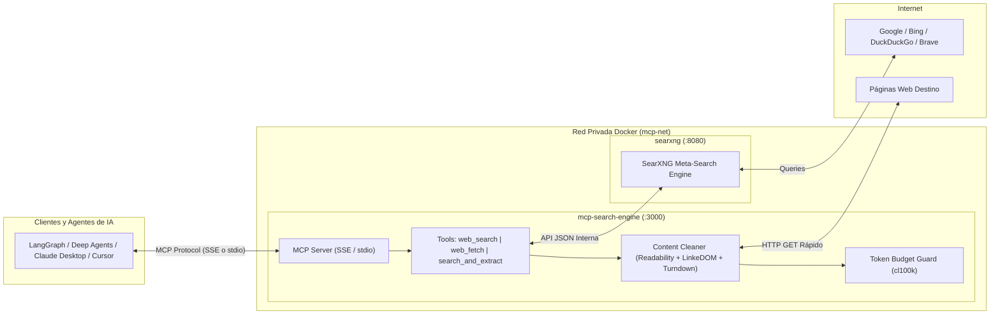

# 🌐 Web Search & Content Extraction MCP Server

> **Alternativa auto-hospedada, privada y 100% gratuita a servicios SaaS como Tavily y Jina Reader.**  
> Diseñada para alimentar agentes autónomos (LangGraph, Deep Agents, Claude Desktop, Cursor) con búsqueda web multi-motor y extracción de contenido optimizada para presupuestos de tokens de LLMs.

---

## 🎯 Características Principales

- **Multi-Motor vía SearXNG**: Agrega resultados de Google, Bing, DuckDuckGo, Brave, Wikipedia y GitHub sin claves API ni costos por consulta.
- **Deduplicación Inteligente**: Filtra enlaces redundantes y deduplica por dominio para maximizar la diversidad de fuentes.
- **Modo Lectura de Alto Rendimiento**:
  - Elimina más del 95% del ruido HTML (anuncios, menús de navegación, footers, scripts, tracking) usando `@mozilla/readability` y el parser ultra-ligero `linkedom`.
  - Convierte el contenido esencial a Markdown limpio mediante `turndown` con soporte para tablas GFM.
  - Elimina imágenes pesadas en base64 para evitar el desperdicio de contexto.
- **Token Budget Guard**: Truncado exacto a nivel de tokens usando `gpt-tokenizer` (cl100k_base / o200k_base), garantizando respuestas acotadas (entre 500 y 1.500 tokens configurables) para evitar desbordar la ventana de contexto de los modelos.
- **Protocolo MCP Nativo**:
  - **Transporte HTTP/SSE**: Ideal para despliegues remotos y microservicios en Docker/Kubernetes.
  - **Transporte `stdio`**: Para integraciones locales directas en Claude Desktop, Cursor o pipelines CLI.

---

## 🏗️ Arquitectura del Sistema



---

## 📁 Estructura del Proyecto

```
web-search-mcp/
├── config/
│   └── searxng/
│       └── settings.yml         # Configuración de SearXNG (JSON habilitado, sin limitador interno)
├── src/
│   ├── config/
│   │   └── env.ts               # Validación estricta de variables de entorno (Zod)
│   ├── extractors/
│   │   ├── content-cleaner.ts   # LinkeDOM + Readability + Turndown (Limpieza HTML -> Markdown)
│   │   └── token-guard.ts       # Control de presupuesto y truncado exacto de tokens
│   ├── services/
│   │   ├── searxng.service.ts   # Cliente SearXNG con deduplicación por dominio
│   │   └── extractor.service.ts # HTTP GET resiliente con extracción en paralelo
│   ├── mcp/
│   │   ├── server.ts            # Factory del MCP Server y registro de herramientas
│   │   ├── tools/
│   │   │   ├── web-search.tool.ts        # Herramienta: web_search
│   │   │   ├── web-fetch.tool.ts         # Herramienta: web_fetch
│   │   │   └── search-and-extract.tool.ts # Herramienta: search_and_extract (tipo Tavily)
│   │   └── transports/
│   │       ├── stdio.transport.ts # Transporte stdio para procesos locales
│   │       └── sse.transport.ts   # Transporte SSE sobre Express para acceso remoto
│   ├── utils/
│   │   └── logger.ts            # Logger seguro que escribe en stderr para no romper stdio
│   └── index.ts                 # Punto de entrada y selección de transporte
├── Dockerfile                   # Construcción multi-stage optimizada
├── docker-compose.yml           # Orquestación con healthchecks y red bridge privada
├── package.json
├── tsconfig.json
└── .env.example
```

---

## 🛠️ Herramientas MCP Registradas

| Herramienta | Parámetros | Descripción |
| :--- | :--- | :--- |
| `web_search` | `query` *(string)*<br>`max_results` *(number, def: 5)* | Busca en múltiples motores, deduplica por dominio y retorna una lista de resultados con títulos, URLs y snippets limpios. |
| `web_fetch` | `url` *(string)*<br>`max_tokens` *(number, def: 1000)* | Descarga una página web, elimina el boilerplate HTML (scripts, anuncios, menús) y retorna el cuerpo en Markdown limpio acotado al límite de tokens. |
| `search_and_extract` | `query` *(string)*<br>`max_results` *(number, def: 3)*<br>`max_tokens_per_page` *(number, def: 1000)* | **Herramienta principal tipo Tavily**: En un solo turno, busca las mejores páginas, extrae su contenido en paralelo y devuelve un reporte estructurado en Markdown listo para síntesis por el LLM. |

---

## 🚀 Despliegue Rápido con Docker Compose

### 1. Clonar y configurar variables de entorno
```bash
cp .env.example .env
```

### 2. Iniciar los servicios
```bash
docker compose up -d --build
```

### 3. Verificar estado de los contenedores
```bash
docker compose ps
```

Ambos servicios cuentan con `healthcheck` integrados:
- **SearXNG**: accesible en `http://localhost:8080` (endpoint de salud: `http://localhost:8080/healthz`).
- **MCP Search Engine**: accesible en `http://localhost:3000` (endpoint de salud: `http://localhost:3000/health`).

---

## 🔌 Configuración de Clientes MCP

### Opción A: Conexión Remota vía SSE (Recomendada con Docker)

Endpoint SSE: `http://localhost:3000/sse`

#### 1. Claude Desktop (`claude_desktop_config.json`) vía `mcp-proxy`:
Si tu versión de Claude Desktop requiere stdio para conectarse a un servidor SSE remoto, puedes usar `mcp-proxy` o `npx`:
```json
{
  "mcpServers": {
    "web-search": {
      "command": "npx",
      "args": ["-y", "mcp-proxy", "http://localhost:3000/sse"]
    }
  }
}
```

#### 2. Agentes en Python (LangGraph / LangChain con `mcp`):
```python
import asyncio
from mcp import ClientSession
from mcp.client.sse import sse_client

async def main():
    async with sse_client("http://localhost:3000/sse") as (read, write):
        async with ClientSession(read, write) as session:
            await session.initialize()
            
            # Listar herramientas
            tools = await session.list_tools()
            print("Herramientas disponibles:", [t.name for t in tools.tools])
            
            # Ejecutar búsqueda y extracción tipo Tavily
            result = await session.call_tool(
                "search_and_extract",
                arguments={"query": "Avances en inteligencia artificial 2026", "max_results": 3}
            )
            print(result.content[0].text)

if __name__ == "__main__":
    asyncio.run(main())
```

---

### Opción B: Conexión Local directa vía `stdio`

Si deseas ejecutar el servidor MCP directamente como un subproceso local de Claude Desktop o Cursor (requiere tener SearXNG corriendo en segundo plano o en Docker):

```json
{
  "mcpServers": {
    "web-search": {
      "command": "node",
      "args": ["/Users/jvc/development/web-search-mcp/dist/index.js"],
      "env": {
        "MCP_TRANSPORT": "stdio",
        "SEARXNG_URL": "http://localhost:8080"
      }
    }
  }
}
```

---

## 💻 Desarrollo Local (Sin Docker para Node.js)

1. Iniciar únicamente SearXNG en Docker:
   ```bash
   docker compose up -d searxng
   ```

2. Instalar dependencias y compilar:
   ```bash
   npm install
   npm run build
   ```

3. Iniciar el servidor MCP en modo SSE (recarga automática):
   ```bash
   npm run dev
   ```

4. Probar en modo stdio interactivo:
   ```bash
   npm run dev:stdio
   ```

---

## 🔒 Buenas Prácticas y Rendimiento

- **Limiter interno**: En `config/searxng/settings.yml`, `server.limiter: false` está configurado para evitar bloqueos por tasa de llamadas en la red interna de Docker.
- **Presupuesto de Tokens**: Por defecto, cada extracción asigna un máximo de 1.000 tokens por página. Puedes ajustar este valor en las llamadas a las herramientas mediante `max_tokens` o a nivel global con `DEFAULT_MAX_TOKENS_PER_PAGE`.
- **Logs Seguros**: Todos los mensajes de diagnóstico se emiten a través de `process.stderr`, garantizando que en modo `stdio` no se corrompa el flujo JSON-RPC de `process.stdout`.
